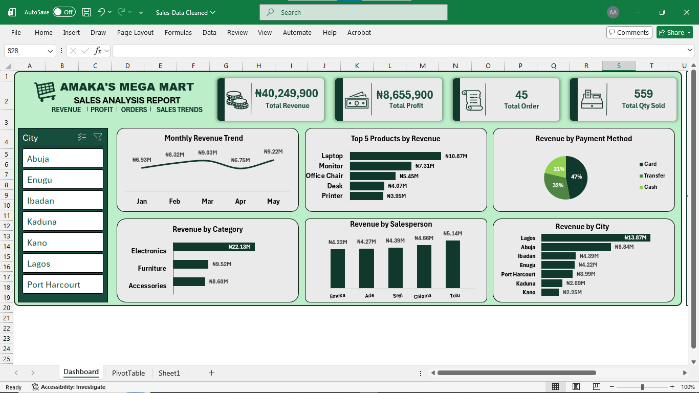

# Amaka's Mega Mart – Sales Performance Analysis

## Project Overview

Amaka's Mega Mart is a Nigerian retail business specialising in electronics, accessories, and furniture across different locations in Nigeria.

This project analyses the company's sales performance, profitability, product contributions, geographical distribution, and monthly revenue trends using an interactive Excel dashboard.

The objective is to transform raw sales data into actionable business insights that support informed decision-making, identify growth opportunities, and improve overall business performance.

## Table of Contents

1. [Dashboard Preview](#dashboard-preview)
2. [Key Business Insights](#key-business-insights)
3. [Key Business Recommendations](#key-business-recommendations)
4. [Assumptions and Limitations](#assumptions-and-limitations)
5. [How to View the Dashboard](#how-to-view-the-dashboard)
6. [Tools and Technologies](#tools-and-technologies)
7. [Repository Structure](#repository-structure)
8. [Author](#author)

## Dashboard Preview



## Key Business Insights

### Overall Sales Performance

* Total Revenue: ₦40,249,900
* Total Profit: ₦8,655,900
* Total Orders: 45
* Total Quantity Sold: 559

### Product Category Performance

* Electronics leads with ₦22.13M in revenue.
* Furniture contributes ₦9.52M.
* Accessories generates ₦8.60M.

### Top-Selling Products

* Laptops generate the highest revenue at ₦10.87M.
* Monitors follow with ₦7.31M.
* Office Chairs contribute ₦5.45M.
* Desks generate ₦4.07M.
* Printers record the lowest revenue at ₦3.95M.

### Monthly Revenue Trends

| Month    | Revenue |
| -------- | ------: |
| January  |  ₦6.93M |
| February |  ₦8.32M |
| March    |  ₦9.03M |
| April    |  ₦6.75M |
| May      |  ₦9.22M |

May recorded the highest monthly revenue, while April experienced a noticeable decline.

### Geographical Sales Performance

* Lagos leads with ₦13.87M.
* Abuja follows with ₦8.84M.
* Ibadan contributes ₦4.39M.
* Enugu contributes ₦4.22M.
* Port Harcourt generates ₦3.99M.
* Kaduna contributes ₦2.69M.
* Kano records ₦2.25M.

### Revenue by Payment Method

* Card: 47%
* Transfer: 32%
* Cash: 21%

Card and transfer transactions collectively account for 79% of total revenue.

### Salesperson Performance

| Salesperson | Revenue |
| ----------- | ------: |
| Tolu        |  ₦5.14M |
| Chioma      |  ₦4.66M |
| Seyi        |  ₦4.39M |
| Ade         |  ₦4.27M |
| Emeka       |  ₦4.22M |

Tolu recorded the highest revenue contribution among the five salespersons.

## Key Business Recommendations

1. **Protect Top-Performing Products:** Monitor inventory levels, demand, and profit margins for laptops and other high-revenue products.

2. **Investigate the April Decline:** Examine changes in customer demand, product availability, pricing, and promotional activities to understand the revenue decline.

3. **Expand Regional Opportunities:** Study the factors driving Lagos's strong performance and identify strategies that could improve sales in other cities.

4. **Strengthen Category Performance:** Explore opportunities to increase Furniture and Accessories sales through targeted promotions, product visibility, and complementary offers.

5. **Improve Salesperson Performance:** Evaluate sales attendants using revenue, profitability, sales targets, and other relevant performance indicators.

6. **Optimise Payment Channels:** Since card and transfer transactions account for approximately 79% of revenue, management should maintain reliable electronic payment channels while continuing to accommodate cash-paying customers.

## Assumptions and Limitations

* The dataset contains 45 orders covering five months (January–May).
* The analysis reflects the information available in the dataset and may not represent the company's complete business operations.
* Revenue and profit figures are based on the available dataset; other operating expenses may not be reflected.
* Revenue contribution alone does not establish product profitability or overall business value.
* The dataset provides descriptive insights rather than sufficient evidence for statistical conclusions or causal relationships.
* Further investigation and additional business data would be required to establish the causes of observed performance changes.

## How to View the Dashboard

* **Quick Look:** View the dashboard screenshot in the `image` folder.
* **Full Report:** Open the PDF report for a detailed explanation of the findings and recommendations.
* **Full File:** Download the Excel workbook from the `excel` folder and open it in Microsoft Excel. Interactive slicers and PivotCharts are best experienced in the desktop application.

## Tools and Technologies

* Microsoft Excel
* Data Cleaning and Preparation
* PivotTables
* PivotCharts
* Interactive Slicers
* Excel Formulas
* Data Visualisation
* Business Intelligence and Reporting

## Repository Structure

```text
Amakas-Mega-Mart-Sales-Analysis/
│
├── README.md
├── Amak_Mega_Mart_Sales_Performance_Report.pdf
│
├── excel/
│   └── Amak_Mega_Mart_Sales_Data_Cleaned.xlsx
│
└── image/
    └── amaka_mega_mart.png
```

## Author

**Abdulmuiz Abdulazeez Arikewushola**

Data Analyst | Excel | SQL | Power BI | Python

[LinkedIn](https://www.linkedin.com/in/torshaw) | [E-mail](aatorshaw.@gmail.com)

---

### About

This project demonstrates the application of Microsoft Excel in transforming raw retail sales data into meaningful business insights through data analysis, interactive visualisation, and business recommendations.

The ultimate goal is to demonstrate how data can move beyond numbers and charts to support better business decisions.
